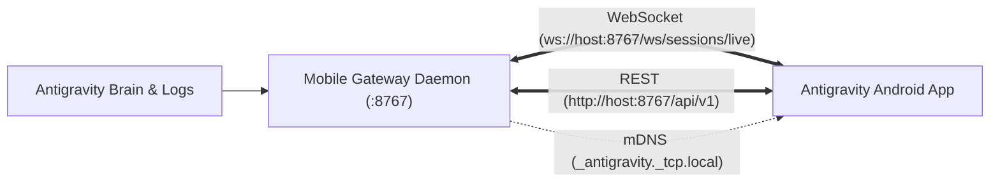

# Antigravity Mobile Daemon

> [!NOTE]
> **Repository Archived**: Google Antigravity now includes native remote control and mobile pairing directly in the desktop application. For the official Android client, please see [antigravity-mobile-companion](https://github.com/ijstt/antigravity-mobile-companion).

[](https://github.com/ijstt/antigravity-mobile-daemon/actions)
[](LICENSE)
[](https://www.python.org/downloads/)

Autonomous, zero-knowledge Edge LAN gateway for Google Antigravity. Connects mobile companion clients (such as Android apps) to desktop Antigravity agents running locally on Linux workstations.

---

## Key Features

- **Real-Time WebSocket Streaming**: Instantaneous push of agent trajectory steps, tool calls, and dynamic reasoning loops without polling.
- **Zero-Cloud & Privacy First**: Runs 100% locally within your home Wi-Fi (LAN). Zero data leaks, zero cloud brokers.
- **Instant QR Pairing**: Generates single-frame pairing QR codes containing host IP, port, and cryptographic Bearer token.
- **Zero-Config Discovery**: Broadcasts mDNS service records (`_antigravity._tcp.local`) for automatic reconnection across dynamic DHCP IP changes.
- **Artifact & Diff Inspection**: REST endpoints for mobile viewing of generated project reports, plans, and diffs.
- **Async Task & Prompt Ingestion**: Enqueues mobile prompts directly into the local conversation stream.

---

## Architecture



---

## Installation & Quickstart

```bash
git clone https://github.com/ijstt/antigravity-mobile-daemon.git
cd antigravity-mobile-daemon

# Create virtualenv and install dependencies
uv venv .venv
source .venv/bin/activate
uv pip install -r requirements.txt

# Run gateway and display pairing QR code in terminal
python -m daemon.main
```

### CLI Options

- `--qr`: Print pairing QR code to terminal and exit.
- `--token`: Print the active authentication Bearer token.
- `--info`: Display local IP, port, and connection payload.
- `--port <PORT>`: Specify custom port (default: `8767`).

---

## API Reference

### REST Endpoints
- `GET /api/v1/health` - Service status, host IP, and active conversation ID.
- `GET /api/v1/auth/qr` - ASCII terminal QR code.
- `GET /api/v1/auth/qr.png` - PNG image of pairing QR code.
- `GET /api/v1/sessions` - List all historical and active agent sessions.
- `GET /api/v1/sessions/active` - Details of the most active session.
- `GET /api/v1/sessions/{id}/transcript` - Full parsed conversation steps.
- `GET /api/v1/sessions/{id}/artifacts` - List of generated artifacts.
- `GET /api/v1/sessions/{id}/artifacts/{name}` - Raw markdown content of artifact.
- `POST /api/v1/sessions/{id}/prompt` - Enqueue mobile prompt into session.

### WebSocket Endpoints
- `WS /ws/sessions/{id}?token=<TOKEN>` - Stream live steps for specific conversation.
- `WS /ws/sessions/live?token=<TOKEN>` - Auto-bind to the currently active conversation.

---

## Running as a systemd User Service

```bash
mkdir -p ~/.config/systemd/user/
cp systemd/antigravity-mobile-daemon.service ~/.config/systemd/user/
systemctl --user daemon-reload
systemctl --user enable --now antigravity-mobile-daemon.service
```

---

## License

MIT License. Copyright (c) 2026 Vladimir Fedorko.
